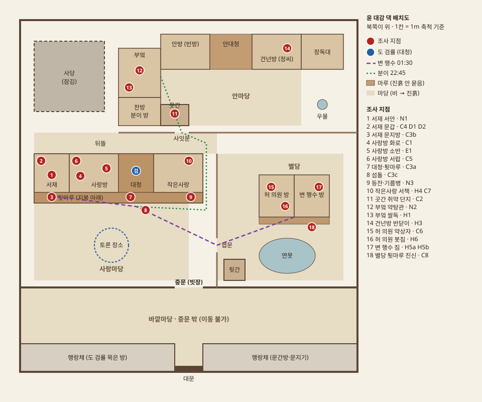

# 고택 맵 배치

> 상태: 초안 (2026-10-11). 게임플레이 기준 블록아웃 치수. 에셋 적용 시 조정.
> 배치도: 

## 1. 좌표 기준 (Unity)

- 1 유닛 = 1m. 원점 (0, 0) = 대문 중앙. **+X = 동쪽, +Z = 북쪽.** 지면 높이 Y = 0.
- 담장 전체: X −24 ~ 24, Z 0 ~ 50 (48m × 50m).
- 건물 기단 높이 0.6m, 처마 아래 툇마루 폭 1.5m, 방 천장 높이 2.4m (블록아웃 기준).

## 2. 구역

| 구역 | 범위 (X, Z) | 비고 |
|---|---|---|
| 대문 | −2~2, 0~1 | 솟을대문 |
| 행랑채 | −24~−2 / 2~24, 0~4 | 서쪽: 도 검률 묵은 방, 동쪽: 문간방(문지기) |
| 바깥마당 | −24~24, 4~12 | **이동 불가.** 도 검률이 중문 밖 출입을 금함 |
| 중문 | −2~2, Z 12 | 안쪽 담장(Z 12)의 문. 사건 당시 빗장 |
| 사랑마당 | −22~0, 13~24 | 흙마당. **토론 장소** (중심 −11, 18) |
| 사랑채 | −22~2, 24~31 | 남향. 앞면 Z 24~25.5 툇마루 |
| ├ 서재 | −22~−17 | 서안, 문갑, 촛대. 툇마루 쪽 문 + 사랑방 쪽 장지문 |
| ├ 사랑방 | −17~−10 | 대감 거처. 화로, 소반, 사방탁자 서랍. 남쪽 창호지 창 |
| ├ 대청 | −10~−5 | 마루. 사랑마당 쪽 중앙 계단. **도 검률 위치** |
| └ 작은사랑 | −5~2 | 재하 방. 서가 |
| 뒤뜰 | −22~4, 31~34 | 사랑채 뒤 좁은 흙길 |
| 사잇담·사잇문 | Z 34, 사잇문 X 1~3 | 안마당과 뒤뜰 사이. 곳간(X −4~0) 바로 동쪽 |
| 안마당 | −4~16, 35~43 | 흙마당 |
| 안채 북쪽 채 | Z 43~48 | 안방(빈방) −4~3, 안대청 3~9, 건넌방(정씨) 9~16. 건넌방 창은 안마당을 내려다봄 |
| 안채 서쪽 채 | −10~−4, 35~46 | 부엌 39~46 (안마당 쪽 문), 찬방·분이 방 35~39 |
| 곳간 | −4~0, 35~38 | 안마당 남서 모퉁이. 문이 부엌 문에서 4m 거리로 보임 |
| 장독대·우물 | 16~22, 43~48 / (19, 38) | 배경 오브젝트 |
| 사당 | −22~−12, 37~47 | **잠김.** 배경 (후속 시나리오용 예약) |
| 별당 구역 | 4~24, 13~31 | 낮은 담(X 4)으로 사랑마당과 구분, 협문 (4, 17~19) |
| ├ 별당 | 10~20, 22~28 | 허 의원 방 10~15, 변 행수 방 15~20. 남쪽 툇마루 |
| ├ 연못 | 중심 (14, 16.5) | 배경 |
| └ 뒷간 | 5~8, 13~16 | 협문 바로 안쪽 |

## 3. 바닥 재질과 진흙 규칙

| 재질 | 위치 | 진흙 |
|---|---|---|
| 마루 | 툇마루, 대청, 안대청 | 묻지 않음. 신을 신은 채 오르면 자국이 남음 |
| 흙마당 | 사랑마당, 안마당, 뒤뜰, 별당 마당 | 비 온 밤 지나면 신에 진흙 |
| 섬돌 | 각 방 앞 디딤돌 | 신을 벗어 두는 곳. 진흙이 떨어져 남음 |

**예법 규칙:** 방이나 마루에 오를 때는 섬돌에 신을 벗는다. 그래서 정상적인 방문은 **섬돌에만** 진흙을 남긴다. 마루 위 신발 자국은 신을 벗지 않고 오른 사람, 즉 서둘렀거나 몰래 움직인 사람의 흔적이다.

## 4. 조사 지점 좌표

| # | 지점 | 좌표 (X, Z) | 단서 |
|---|---|---|---|
| 1 | 서재 서안 | (−19.5, 28) | N1 |
| 2 | 서재 문갑 | (−21, 30) | C4, D1, D2 |
| 3 | 서재 문지방 | (−19.5, 25) | C3b |
| 4 | 사랑방 화로 | (−13.5, 27.5) | C1 |
| 5 | 사랑방 소반 | (−12, 28.5) | E1 (공개) |
| 6 | 사랑방 서랍 | (−16, 30) | C5 |
| 7 | 대청·툇마루 바닥 | (−7.5, 25) | C3a |
| 8 | 섬돌 (작은사랑 앞 / 사랑방 앞) | (−1.5, 23.5) / (−13.5, 23.5) | C3c |
| 9 | 툇마루 등잔 / 작은사랑 앞 빈 기름병 | (−4.5, 25.2) | N3 |
| 10 | 작은사랑 서가 | (0, 30) | H4, C7 (심층) |
| 11 | 곳간 쥐약 단지 | (−2, 36.5) | C2 |
| 12 | 부엌 약탕관 | (−7, 43) | N2 |
| 13 | 부엌 쌀독 | (−8.5, 40) | H1 (심층) |
| 14 | 건넌방 반닫이 | (14, 46) | H3 (심층) |
| 15 | 허 의원 약상자 | (12, 26) | C6 |
| 16 | 허 의원 봇짐 | (14, 27) | H6 (심층) |
| 17 | 변 행수 짐 보따리 | (18.5, 27) | H5a, H5b (심층) |
| 18 | 별당 툇마루 진신 | (17.5, 21.5) | C8 |

## 5. 타임라인 시야·동선 검증

| 타임라인 사건 | 배치상 근거 |
|---|---|
| 20:10 재하가 작은사랑 문틈으로 대청을 서성이는 변 행수를 봄 | 작은사랑과 대청이 붙어 있음 |
| 20:35 분이가 부엌 앞에서 곳간을 나오는 재하를 봄 | 부엌 문(−4, 42)과 곳간 문 사이 4m, 같은 안마당 |
| 22:50 정씨가 건넌방 창으로 안마당을 건너는 분이를 봄 | 건넌방 창이 안마당을 향함 |
| 23:00 재하가 진흙 없이 사랑방에 다녀옴 | 작은사랑 → 대청 → 툇마루 → 사랑방이 모두 마루 |
| 23:05 변 행수가 뒷간에서 돌아오다 사랑방 앞 그림자를 봄 | 뒷간(5~8, 13~16)에서 협문 너머로 불 켜진 사랑방 창(약 22m)이 보임. 그림자는 창 앞 툇마루를 지나 대청 쪽으로 감 |
| 23:20~23:35 재하가 벽 너머 사랑방 대화를 들음 | 대청 폭 5m, 문은 창호지. 고요한 밤 |
| 00:48 재하가 대청을 지나는 작은 그림자를 봄 | 분이가 중앙 계단으로 대청에 올라 툇마루를 따라 서쪽 서재로 감 |
| 01:30 변 행수의 진신 자국이 서재 문지방까지 | 별당 → 협문 → 사랑마당 → 대청 계단 → 툇마루 → 서재. 신을 신은 채 오름 |
| 01:45 허 의원이 돌아온 변 행수를 봄 | 별당 두 방이 붙어 있음 |
| 중문 밖 도 검률은 현장에 들어갈 수 없었음 | 행랑채는 중문 밖. 문지기 증언 |

## 5-1. 걸어서 검증 (Unity, 2026-10-11)

Play 모드에서 캐릭터 컨트롤러로 문 20곳을 자동 보행 점검했다. 발견·수정한 문제:
- 툇마루 등잔이 문 정중앙에 있어 진입 차단 → 문 옆으로 이동, 작은 소품 충돌체 제거
- 캐릭터가 턱을 오를 때 먼저 stepOffset만큼 올라가 문 인방에 머리가 걸림 → 문 높이 2.2m, stepOffset 0.35m (단차는 모두 0.3m 이하)
- 사잇문이 곳간 남쪽 벽에 막힘 → 사잇문을 X 1~3으로 이동

## 6. 단계별 배치

| 단계 | 플레이어 위치 | 도 검률 |
|---|---|---|
| 리딩·자기소개·첫 검시 발표 | 사랑마당 토론 장소에 모여 있음 (이동 불가) | 대청 계단 위 |
| 조사 | 중문 안 자유 이동 (사당 제외) | 대청 |
| 토론·변론·투표 | 사랑마당 토론 장소로 자동 이동 | 대청 계단 위 |

## 7. 분위기

- 비 갠 이른 아침. 옅은 안개, 흐린 하늘, 젖은 기와와 마당의 물웅덩이. 공포가 아닌 차분하고 쓸쓸한 톤.
- 시간이 흐를수록(진시 → 사시) 안개가 걷히고 햇빛이 든다. 게임 속 시각을 빛으로 표현.
- 소리: 처마 낙숫물, 새소리, 멀리 개 짖는 소리.

## 8. 에셋 적용 — 김명관 고택 (KHS) 씬

블록아웃의 치수 대신 **국가유산청 "김명관 고택(정읍)" 실측 스캔을 그대로 쓰고, 우리 장소를 실제 건물에 배정**했다 (2026-10-11).
좌표는 KHS 원본 x·z 그대로, 높이는 마당을 y = 0으로 올렸다. 생성기·검증기는 10절.

| 우리 장소 | 고택의 실제 공간 | 좌표 (x, z) |
|---|---|---|
| 대문 · 행랑채 | 남쪽 긴 행랑채, 대문은 서쪽 칸 | 행랑채 −18~18, −21~−32 |
| 바깥마당 (**출입 금지**) | 대문 안 서쪽 작은 마당, 초가 헛간 옆 | −12~−3, −12~−22 |
| 중문 | 바깥마당 동쪽 담의 문 (보이지 않는 벽으로 막음) | (−2.1, −17.2) |
| 도 검률 묵은 방 | 행랑채 서쪽 방 (바깥마당 쪽) | 배경 |
| 사랑마당 (**토론 장소**) | 사랑채와 행랑채 사이 흙마당 | 중심 (8, −18.5) |
| 사랑채 | 남향, 앞 툇마루 + 섬돌 | 4.6~17, −8.3~−14.2 |
| ├ 사랑방 (대감 거처) | 서쪽 큰 방, 앞쪽 창호가 툇마루를 향함 | 4.6~9.4, −8.6~−12.6 |
| ├ 서재 | 대청 뒤 북쪽 방. 대청 쪽 문 + **사랑방 쪽 문** | 9.5~12.2, −8.3~−10.1 |
| ├ 대청 | 가운데 마루. 앞 분합문은 닫혀 있음 | 9.5~15, −10.1~−12.7 |
| ├ 작은사랑 (재하) | 동쪽 끝 방, 대청과 붙음 | 15~17, −10~−14 |
| └ 툇마루 · 섬돌 | 앞 툇마루 z −12.8~−14.1, 섬돌 z −14.6 | — |
| 별당 (손님방 두 칸) | 행랑채 동쪽 끝 마루방 두 칸, 사랑마당을 향함 | 허 의원 8.7~11.2 / 변 행수 11.2~13.6, −26.8~−29.9 |
| 뒷간 | 남동쪽 구석 담 두른 작은 채 | (20.3, −29.2) |
| 안마당 | 안채 ㅁ자 안뜰 | −15~4, 0.8~7 (+ 북쪽 오목한 부분) |
| 안채 입구 (중문간) | 안채 남쪽 줄 가운데 칸. 사랑채 옆 디딤돌 길이 이어짐 | −8~−2.5, 0~−3 |
| 부엌 | 서쪽 날개 흙바닥 긴 방, 안마당 쪽 문 2개 | −19~−16, 0~7.6 |
| 곳간 | 남쪽 줄, 항아리가 놓인 칸 | −13.8~−11, 0~−3 |
| 안방(빈방) · 안대청 · 건넌방(정씨) | 북쪽 ㄷ자: 서쪽 날개 · 가운데 · **동쪽 날개(창이 안마당 쪽)** | 건넌방 −3.7~1, 6.6~15 |
| 사당 (**잠김**) | 북동쪽 담장 안 사당 (문짝 닫힘) | (12, 22) |
| 뒤뜰·장독대 | 안채 북쪽·서쪽 넓은 터 | 자유 이동 |

### 5절 시야·동선 재검증 (김명관 고택 배치)

| 타임라인 사건 | 새 배치의 근거 |
|---|---|
| 20:10 재하가 작은사랑 문틈으로 대청의 변 행수를 봄 | 작은사랑이 대청 동쪽에 바로 붙음 |
| 20:35 분이가 부엌 앞에서 곳간을 나오는 재하를 봄 | 부엌 문(−16.1, 1.2) ↔ 곳간(−12.4, −1.2) 약 4m, 같은 안마당 |
| 22:50 정씨가 건넌방 창으로 안마당을 건너는 분이를 봄 | 건넌방(북쪽 동쪽 날개)의 문·창이 안마당을 향함 |
| 23:00 재하가 진흙 없이 사랑방에 다녀옴 | 작은사랑 → 대청 → 사랑방이 모두 실내 마루 |
| 23:05 뒷간에서 돌아오던 변 행수가 사랑방 불빛 앞 그림자를 봄 | 뒷간 → 사랑마당을 지나며 사랑방 앞 툇마루 창호가 정면으로 보임 (약 12~18m) |
| 23:20~23:35 재하가 벽 너머 사랑방 대화를 들음 | 작은사랑과 사랑방 사이 대청 약 5.6m, 문은 창호지 |
| 00:48 재하가 대청을 지나는 작은 그림자(분이)를 봄 | 서재가 대청 북쪽에 붙어 있어 대청을 가로질러 감 |
| 01:30 변 행수의 진신 자국이 서재 문지방까지 | 별당(행랑채 동쪽) → 사랑마당(흙) → 섬돌 → 툇마루 → 대청 → 서재 문지방 |
| 01:45 허 의원이 돌아온 변 행수를 봄 | 별당 두 칸이 문 하나로 붙어 있음 |
| 중문 밖 도 검률은 현장에 들어갈 수 없었음 | 도 검률 방은 바깥마당 쪽 행랑채, 중문은 막힘 |

- 블록아웃과 달라진 점: 서재가 사랑방 **서쪽**이 아니라 대청 **뒤**에 있다(사랑방과 문으로 이어진 점은 같음). 별당은 독립 채가 아니라 행랑채 동쪽 끝 손님방 두 칸이다. 협문은 없다(사랑마당이 별당 앞마당을 겸함). 시나리오북·데이터 문장은 바꿀 필요가 없었다.

## 9. 블록아웃 생성

- 씬: `Assets/_Project/Scenes/Manor_Blockout.unity` (Unity 6000.3.19f1 LTS, URP)
- 생성기: `Assets/_Project/Scripts/Editor/ManorBlockoutBuilder.cs` — 메뉴 `Tools > Manor > Build Blockout Scene`. 다시 실행하면 씬을 처음부터 새로 만든다. **좌표는 씬이 아니라 이 스크립트에서 고친다.**
- 조사 지점은 `InvestigationSpot`(단서 ID·층), 스폰/NPC/토론 위치는 `GameplayMarker` 컴포넌트로 들어간다.
- 검증 캡처: `-executeMethod MurderMystery.EditorTools.ManorBlockoutBuilder.CaptureViews -captureOut docs/design/blockout`

| 위에서 (지붕 숨김) | 남동쪽 조감 |
|---|---|
|  |  |

### 플레이 화면 (프로토타입, 2026-10-11)

| 조사 안내·획득 | 수첩 | 엔딩 |
|---|---|---|
|  |  |  |

## 10. 김명관 고택 씬 생성·검증

- 씬: `Assets/_Project/Scenes/Manor_KHS.unity` (빌드 첫 씬). 블록아웃 씬은 비교용으로 남겨 둔다.
- 생성기: `Assets/_Project/Scripts/Editor/KhsManorBuilder.cs` — 메뉴 `Tools > Manor > Build KHS Manor Scene`. KHS 데모 씬을 가져와 마당을 y = 0으로 올리고, 깨진 충돌체(2027개, 메시 참조가 빠져 있음)를 다시 만들고, 방 문짝은 통과·대문/사당 문은 닫힘, 땅·섬돌·보이지 않는 벽(바깥마당, 동쪽 협문)·조사 지점·마커·도 검률을 배치한다. **좌표는 이 스크립트의 표에서 고친다.**
- 플레이어 몸: 문지방 위 문 높이가 1.74m라 키 1.45m·계단 0.15m로 줄이고, 0.6m 기단은 `StepAssist`(앞이 막히고 위가 비어 있으면 몸을 올려 줌, 최대 0.62m)로 오른다. 0.85m인 행랑채 기단 앞에는 섬돌을 더 놓았다.
- 검증 1 (`KhsManorBuilder.VerifyWalkability`): NavMesh로 토론 장소 → 모든 조사 지점·NPC·스폰 도달, 바깥·바깥마당·사당으로 새는 길 없음. 그림 `Library/khs_walk.png`.
- 검증 2 (`WalkabilityProbe`, Play 모드): 플레이어와 같은 CharacterController가 실제로 걸어서 21곳 모두 도달 (2026-10-11).
